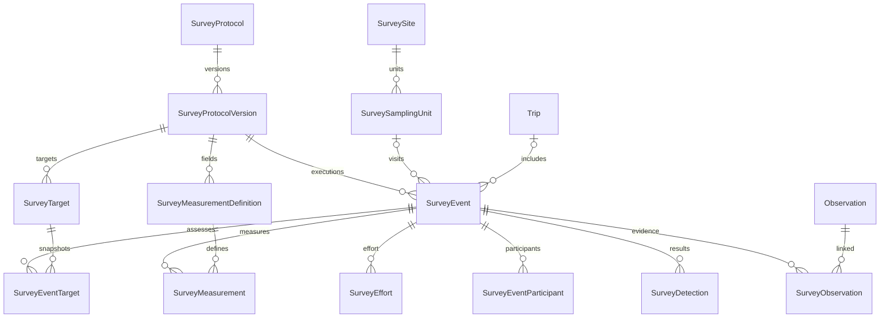

# Survey database and Rails backend v0.2

Implemented October 15, 2026. Backend only: no HTTP endpoints, UI, search indexes,
observation callbacks, or taxonomy changes. See [implementation results](survey_implementation_report.md)
and the workspace [decision record](decisions/001-survey-backend-v02.md).

## Compatibility and schema

Rails 6.1.7.9, Ruby 3.3.7, PostgreSQL 17.11, PostGIS 3.6.4 were tested.
The schema uses the existing `uuid-ossp` extension. New internal IDs and internal
foreign keys are bigint; references to existing users, taxa, places, observations,
and posts are integer, matching those tables. No new gem is required.

| Table / model | Relationships and purpose |
| --- | --- |
| `survey_protocols` / SurveyProtocol | User-owned registry with stable UUID; has versions; draft/active/archived |
| `survey_protocol_versions` / SurveyProtocolVersion | Numbered immutable publication; has targets, measurement definitions and events |
| `survey_targets` / SurveyTarget | Protocol-version biological intent; optional existing Taxon, original name and external URI |
| `survey_measurement_definitions` / SurveyMeasurementDefinition | Versioned field key, type, unit, vocabulary, event/detection scope and numeric bounds |
| `survey_sites` / SurveySite | Stable UUID; creator; optional Place; monitoring site with location classification and geometry |
| `survey_sampling_units` / SurveySamplingUnit | Stable UUID and site-local code; optional same-site parent; repeated spatial identity |
| `survey_events` / SurveyEvent | Stable UUID; protocol version, owner, optional site/unit/Trip/parent event; actual sampling geometry |
| `survey_event_targets` / SurveyEventTarget | Adopted target snapshots and explicit assessment, coverage and absence-reporting flags |
| `survey_event_participants` / SurveyEventParticipant | Registered user or historical participant name; role grants no authority |
| `survey_efforts` / SurveyEffort | Multiple methods, times, duration/distance/area, observers, replicates and conditions |
| `survey_detections` / SurveyDetection | Independent counts and explicit non-detections; optional target/effort/taxon/recorder |
| `survey_observations` / SurveyObservation | Explicit evidence links to existing Observations; optional same-event detection |
| `survey_measurements` / SurveyMeasurement | Exactly one typed value, using a definition belonging to the event's version |



All 13 tables have conventional timestamps. Four requested external UUIDs, plus
a detection ingestion UUID, are unique, non-null and immutable. Internal IDs are
not public identifiers. NULL quantities mean unknown/not supplied, never zero.
There is deliberately no uniqueness constraint on event/taxon detections or on
measurement values: independent repeated records are legitimate.

## Services and lifecycle

Services are ordinary autoloaded classes under `lib/`, matching the repository's
existing service location. Each operation uses a transaction/savepoint and row
locks. They raise `ActiveRecord::RecordInvalid` for model/completion validation,
`ArgumentError` for unsupported service transitions, or PostgreSQL-backed
`ActiveRecord::StatementInvalid` for database integrity failures.

```ruby
version = protocol.survey_protocol_versions.create!(version_number: 1)
# Populate targets and measurement definitions, then:
PublishSurveyProtocolVersion.call(version)
event = CreateSurveyEvent.call(protocol_version: version, user: observer,
  survey_sampling_unit: station, trip: trip, started_at: Time.current)
# Record assessments, effort, detections, evidence and measurements.
CompleteSurveyEvent.call(event)
UnlinkSurveyObservation.call(link)
UnlinkSurveyEventFromTrip.call(event)
event.void!(reason: "Incorrect station; replacement event UUID …")
```

Publication requires at least one valid target. Drafts are editable; published
versions may only retire. Retirement cannot restore draft status or rewrite
instructions, configuration, targets, measurement definitions, publication time,
number or protocol reference. Protocol archiving changes the registry lifecycle
without deleting publications. Retiring versions explicitly prevents new use;
archiving alone does not retire a version.

Event initialization accepts only a published version, even for planned events.
It copies every target's label, scope type and scope definition, original taxon
ID/name and external URI atomically. The version reference is permanent from
creation, a stronger rule than freezing it only on completion. Direct SQL may
create an unfinished event, but cannot complete it with missing target snapshots.

`planned` may advance to `in_progress` or `completed`; active events cannot return
to planned. Published versions are required for activation and completion.
Completion validates the start time, required target assessments, required
measurements, effort configuration, timing, and absence context. A finished visit
may retain `completion_status: incomplete` or `unknown`; lifecycle completion
and scientific coverage are separate facts. No missing results become zeros.

Completion freezes the event's scientific fields and all assessments, effort,
participants, detections and measurements. Voiding with a nonblank reason is
allowed, records a timestamp, and is terminal. Corrections require a replacement
event; retain its UUID in the void reason. There is no generalized revision or
approval workflow. Completed evidence links may be removed, but new evidence
cannot be attached to a completed event in this initial policy.

`completed_at` remains present after voiding. This ensures that a used sampling
unit cannot be moved after its original visit is voided. Geometry, dimensions,
site, parent, code and unit type freeze after completed use; name/description and
retirement metadata remain editable. Use a replacement unit for material changes.
The actual event geometry can differ from the reusable unit. Initialization copies
unit geometry only if the caller omitted `geom`; no subsequent site/unit edits
propagate to events. Site geometry is not implicitly copied.

## Supported scientific configuration

Unknown keys or invalid JSON shapes fail database checks. No code is evaluated.
The following is the entire protocol configuration language:

```json
{
  "allowed_methods": ["point_count"],
  "require_effort": true,
  "required_effort_fields": ["duration_seconds", "observer_count"],
  "allow_skipped_targets": false,
  "allow_not_applicable_targets": false,
  "allow_effort_outside_event": false
}
```

All keys are optional. Defaults are unrestricted nonblank methods, at least one
effort record, no mandatory effort quantities, no skipping required targets,
no not-applicable exceptions for required targets, and effort inside known event
time bounds. Array options, when present, must be nonempty arrays of strings.
Required effort fields are limited to duration_seconds, distance_meters,
area_square_meters, observer_count and replicate_number. Each effort row must
supply each required field before completion. Explicit zero is allowed for
nonnegative quantities; observer/replicate counts must be positive.

Targets use one of:

- `taxon`: existing taxon ID, original scientific name, empty scope object.
- `taxon_group`: `{"description":"All birds in the survey area"}`, optional taxon.
- `verbatim`: `{"description":"Occupied nests"}`, no taxon ID.

The scope description is intentionally simple. Core taxon relationships are
foreign keys, not lists embedded in JSON. Group membership logic and complex
sampling rules require a future design rather than silent interpretation.
Inactive taxa remain valid references. No callback follows taxon changes or
retargets historical records. A detection's reported taxon may differ from its
original target.

Measurements support numeric, text, boolean and categorical definitions. Categorical
`allowed_values` is a nonempty array of distinct nonblank strings; other types use
`[]`. Numeric `validation_rules` supports only optional inclusive `min` and `max`
numbers, with min <= max. Other types use `{}`. Units must match exactly, including
NULL for a unitless definition. Exactly one value is populated; false is a real
boolean value. Numeric values must be finite. Event-scoped fields forbid detection
IDs; detection-scoped fields require them. Repeated measurements are permitted.
A required detection-scoped definition applies to each detection, including an
explicit non-detection. With no detections, that requirement is vacuous.

Absence reporting requires status `surveyed`, coverage_complete true, and positive
sampling duration, distance or area somewhere in the event. Observer count alone
is insufficient. An explicit absent detection must refer to such a target, with
quantity NULL or zero and no qualitative count. Reverse checks prevent deleting
or zeroing the last positive effort or disabling its supporting assessment while
absence claims exist. Positive effort is a conservative eligibility floor, not
proof of biological absence or of protocol-specific detectability. More precise
target-to-effort coverage and protocol thresholds are deferred.

## Database integrity and concurrency

The schema has 32 foreign keys, 43 CHECK constraints and 13 primary keys.
The 57 indexes include primary keys, unique keys, foreign-key lookup paths and
three GiST indexes. Exact definitions are in `db/structure.sql` and the five
migrations, with SQL migration assets under `db/survey_v02/`.

Unique indexes cover UUIDs, protocol/version number, non-null target positions
within a version, measurement field keys, site/unit codes, event/target pairs,
registered participant/event pairs and observation/event pairs. Supporting unique
(id,event) and (id,site) pairs enable composite FKs. Foreign-key lookup indexes
include reverse observation/taxon/effort lookups and unit/time monitoring history.
Measurements have an event/definition index; detections have an event/target index.

Composite FKs enforce detection/target/event, detection/effort/event,
observation/detection/event, measurement/detection/event, event/unit/site, and
unit/parent/site consistency. Nullable components use explicit checks where needed,
particularly requiring a site whenever an event has a unit. All other references
have ordinary FKs. CHECKs enforce enums, mandatory data, supported configuration,
nonnegative/finite quantities, exactly-one-value, time ordering and local lifecycle
or absence rules.

Geometry columns use `geometry(Geometry,4326)`, valid nonempty point, line,
polygon or corresponding multi-geometries in 2D WGS84 longitude/latitude bounds.
Geometry collections, invalid polygons and mismatched SRIDs are rejected. No
existing Place/Observation geometry convention was changed.

Custom trigger functions are narrowly scoped:

| Function(s) | Why a FK/CHECK is insufficient |
| --- | --- |
| `survey_guard_protocol_version`, `survey_guard_protocol_child` | Compare old/new lifecycle and scientific definitions; serialize child edits with publication |
| `survey_guard_unit_hierarchy`, `survey_guard_event_hierarchy` | Recursive ancestry checks and simultaneous inverse edges |
| `survey_guard_event` | Historical freezing, permanent identity, published version transitions and Trip STI |
| `survey_guard_trip_type` | Reject reverse STI changes on a referenced Post; only trigger added to a legacy table |
| `survey_guard_event_child` | Serialize scientific child mutations with completion and reject changes after completion/voiding |
| `survey_guard_event_target` | Join protocol definitions, validate version and all copied snapshot fields |
| `survey_guard_effort` | Method and timing rules come from another table |
| `survey_guard_detection`, `survey_check_absence_context` | Check target coverage and positive effort in both write directions |
| `survey_guard_measurement` | Join immutable definition for type, unit, range, vocabulary and scope |
| `survey_guard_observation_link` | Permit explicit evidence unlinking while preventing historical insertions/rewrites |
| `survey_enforce_event_completion`, `survey_completion_errors` | Validate the complete relationship graph and preserve completion provenance |
| `survey_freeze_used_unit` | Detect completed historical use, including subsequently voided visits |
| `survey_guard_stable_uuid` | Reject updates to protocol/site external identity |

Ordinary FK/CHECK failures occur immediately. Trigger checks also run immediately;
clients should record effort before enabling absence reporting, then record
non-detections, then complete. This ordering avoids a broad deferred trigger system.

Child writes update the parent timestamp before checking invariants. This both
locks and creates a row version: a higher-isolation transaction must fail rather
than silently reuse an old parent snapshot. Completion locks a used sampling unit
to coordinate geometry freezing. Hierarchy edits use one transaction-scoped
advisory lock per hierarchy and require READ COMMITTED isolation (the Rails
default). These short locks affect writes only. Clients should retry an entire
transaction on a PostgreSQL deadlock/serialization failure. Ingestion clients must
reuse a detection UUID on retry; automatic UUID generation alone cannot identify
a retry from a client that supplies a new identifier each time.

## Deletion, privacy and Trip compatibility

Referenced protocols, versions, sites, units and scientific children cannot be
physically deleted through ordinary SQL or Rails. Unreferenced drafts can be
removed in dependency order. Completed and void events cannot be deleted, even
if they have no children. No scientific parent uses cascading deletion.

Trip continues to inherit Post. The only Ruby changes to Trip are the optional
`has_many :survey_events, dependent: :nullify` and
`structured_survey_observations`, which queries explicit links with a SQL subquery.
The existing Post observations join, Trip observations discovery, TripTaxon,
TripPurpose and Elasticsearch presence_absence implementation are untouched.

Deleting a Post/Trip nullifies `trip_id`. Deleting an underlying Observation
cascades only into its optional SurveyObservation links, preserving events and
detections. Other survey references to users, taxa and places restrict deletion.
This can block account/taxon/place deletion when scientific records refer to them;
no anonymization or taxon remapping policy is silently applied.

Sites and events default to private; units inherit their site's classification.
Default JSON/XML serialization of every survey model excludes geometry and does
not follow `include`/`methods` options. This prevents accidental paths into an
associated private site, unit or Observation. `inspect` filters geometry, and a
survey-only PostGIS type wrapper uses Rails' existing binary-bind redaction for
routine persistence SQL logs. These guards apply to public sites too until an
authorized disclosure layer exists.

Privacy is **not complete**. Direct `.geom`/`.attributes`, raw SQL/bulk writes,
operator database statement logs, custom serializers and arbitrary remarks remain
privileged interfaces and can contain location information. No public API exists.
Access checks, sensitive-taxon policy, classification propagation, sanitization of
free text, logging configuration, and authorized exports are required before
exposure. In particular, the local Docker PostgreSQL configuration logs statements;
no deployment setting was changed in this task. Default model serializers do not
constitute access control.

## Deliberate differences and follow-up decisions

- Added detection UUID for retry deduplication, event location_privacy, completed_at,
  voided_at and void_reason for standalone privacy classification and retained history.
- Event protocol identity freezes at creation; new events require publication even
  while planned. Published versions require at least one biological target.
- Snapshot creation is atomic in the creation service; direct SQL incomplete events
  remain possible but cannot complete without the full target set.
- Geometry snapshots may be NULL for imported/nonspatial events; sampling-unit
  geometry is copied when available, while site geometry is never copied implicitly.
- Correction is void-and-replace with a textual replacement reference, not a new
  correction table. Qualitative absence quantities are disallowed rather than parsed.
- Time-zone name recognition is Rails-only. Default serialization and routine SQL
  bind redaction are Ruby-only. Snapshot name autofill and initialization convenience
  are Ruby operations; database constraints enforce their persisted consistency.
  All eleven requested cross-table integrity invariants are database-enforced.
- Migrations are intentionally irreversible via `db:rollback`; destructive removal
  of scientific records needs a retention decision. Migrations and dump loading
  have both been tested without dropping existing development data.

Before the next backend milestone, settle authorization and disclosure policy,
account erasure/anonymization, retired-unit use, correction linking, and real-world
protocol effort thresholds. Then implement a small authorized backend operation
layer exercised by a real point-count workflow. HTTP/UI/export/search remain
separate work.
